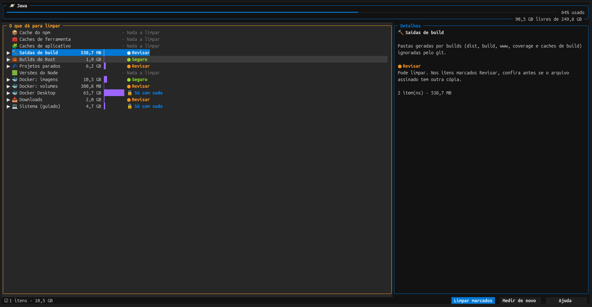

# Jawa

Limpeza de disco para quem programa no Linux, pelo terminal: encontra o que as ferramentas de desenvolvimento acumulam, explica cada item e só apaga depois de várias verificações de segurança.



O nome vem dos Jawas de *Star Wars*, os catadores que percorrem o deserto recolhendo sucata.

## Instalar

Somente Linux x86_64.

**Pacote `.deb`** (Debian, Ubuntu e derivados), baixado da página de [Releases](https://github.com/Otaviofachin/jawa/releases):

```bash
sudo apt install ./jawa_0.2.0-1_amd64.deb
```

**Binário `tar.gz`**, também nos Releases:

```bash
tar -xzf jawa-0.2.0-x86_64-linux.tar.gz
install -m 755 jawa-0.2.0-x86_64-linux/jawa ~/.local/bin/jawa
```

Cada arquivo vem com um `.sha256` para conferir (`sha256sum -c`).

**Pelo código-fonte** (precisa do Rust 1.88 ou mais novo):

```bash
cargo install --git https://github.com/Otaviofachin/jawa jawa
```

**Interface nova (recomendada)**, feita com [Textual](https://textual.textualize.io). Precisa do [uv](https://docs.astral.sh/uv/) e do `jawa` instalado por um dos jeitos acima:

```bash
uv tool install "git+https://github.com/Otaviofachin/jawa#subdirectory=tui"
```

Com ela instalada, `jawa` abre a interface nova; sem ela, abre a interface embutida.

## Como usar

Rode `jawa`. A interface abre no terminal e mede tudo o que dá para limpar (só lendo, nunca apagando). À esquerda ficam as categorias, que abrem nos itens; à direita, os detalhes do que está sob o cursor.

| Tecla | O que faz |
|---|---|
| `↑`/`↓` ou `j`/`k` | move o cursor |
| `Enter` | abre a categoria (num item, marca ou desmarca) |
| `Espaço` | marca ou desmarca (na categoria, todos os itens dela) |
| `l` | limpa os itens marcados (abre a confirmação) |
| `m` | mede de novo |
| `?` | ajuda |
| `q` | sai |

Também dá para clicar com o mouse. As etiquetas dizem o risco de cada categoria: `● Seguro` (volta sozinho, já vem marcado), `● Revisar` (você escolhe item por item) e `🔒 Só com sudo` (o Jawa só mostra o comando para você rodar). Itens irreversíveis pedem que você digite `apagar` na confirmação. No fim, o resultado mostra o que voltou ao disco e o que ainda está na Lixeira ou dentro da VM do Docker Desktop.

### Configuração

Fica em `$XDG_CONFIG_HOME/jawa/config.toml`:

```toml
project_roots = ["/home/eu/field"]   # vazio = detectar
idle_days = 30                       # 1..=365
```

Sem `project_roots`, o Jawa detecta as pastas até 2 níveis abaixo da pasta pessoal (sem ocultas, `snap` nem Downloads) que tenham pelo menos 2 repositórios git como filhos diretos.

O histórico fica em `$XDG_STATE_HOME/jawa/historico.jsonl` e o log de diagnóstico em `$XDG_STATE_HOME/jawa/jawa.log`.

## O que ele limpa

Itens abaixo de 1 MiB não aparecem. Sem a ferramenta (git, docker, nvm, snap, apt), a categoria explica por que não há o que mostrar.

| Id | Título | Risco | Reversibilidade | O que entra |
|---|---|---|---|---|
| `npm-cache` | Cache do npm | Seguro | Regenerável | `~/.npm/_cacache`, `~/.npm/_npx` |
| `caches-ferramentas` | Caches de ferramentas | Seguro | Regenerável | Em `$XDG_CACHE_HOME`: `ms-playwright`, `Cypress`, `puppeteer`, `yarn`, `pnpm`, `node-gyp`, `typescript`, `pip`, `prisma`, `go-build`, `thumbnails`. Na pasta pessoal: `.gradle/caches`, `.cargo/registry`. Versões antigas do Claude Code em `~/.local/share/claude/versions` (exceto o alvo de `~/.local/bin/claude`) |
| `caches-apps` | Caches de aplicativos | Seguro (bloqueado com o app aberto) | Regenerável | `$XDG_CACHE_HOME/{google-chrome,chromium,mozilla,spotify}` e caches conhecidos de Code, Slack e Discord em `~/.config` |
| `saidas-build` | Saídas de build | Seguro (Revisar se houver artefato assinado) | Regenerável | `dist`, `build`, `www`, `coverage`, `.angular/cache`, `.nx/cache` até 3 níveis dentro de cada repo, só se ignorados pelo git |
| `rust-target` | Builds do Rust | Seguro | Regenerável | `target/` ao lado de um `Cargo.toml`; dentro de repo, só se ignorado |
| `node-modules-parados` | Dependências de projetos parados | Revisar | Regenerável | `node_modules` (até 3 níveis) de projetos parados. A nota traz o comando de reinstalação e avisa sobre registry privado |
| `nvm-versoes` | Versões antigas do Node (nvm) | Revisar | Regenerável | `$NVM_DIR/versions/node/v*`, menos as protegidas |
| `docker-imagens` | Docker: imagens e cache de build | Seguro | Regenerável | `docker image prune -a -f` e `docker builder prune -a -f` |
| `docker-volumes` | Docker: volumes e containers parados | Revisar | **Irreversível** | Um item por volume `dangling` + um item "containers parados" |
| `docker-desktop-disco` | Disco virtual do Docker Desktop | Guiado / Revisar | Irreversível | `Docker.raw` com tamanho real. Com Docker Desktop instalado: só o comando guiado. Sem ele: Revisar |
| `downloads` | Downloads grandes e antigos | Revisar | Lixeira | Pacotes (`.deb`, `.rpm`, `.AppImage`, `.iso`, `.img`, `.tar.gz`, `.tgz`, `.tar.xz`, `.zip`) de 10 MB ou mais; qualquer item de 100 MB ou mais; itens de 10 MB ou mais parados há 90 dias |
| `sistema` | Sistema (modo guiado) | Guiado | — | journald acima de 200 MB, `.deb` em `/var/cache/apt/archives`, revisões `disabled` de snap, `/var/crash/*.crash` |

Cada categoria tem uma explicação com seis campos (o que é, por que cresce, o que acontece ao limpar, dá para desfazer, custo para recriar e recomendação), disponível na interface com a tecla `e`.

Ao final, o relatório mostra o espaço **estimado** (soma dos itens) e o **medido** (diferença do espaço livre na pasta pessoal). Se o medido for menos da metade do estimado, o Jawa avisa que parte do espaço pode estar presa em snapshots (Btrfs/Timeshift) ou na Lixeira.

## Regras de segurança

As travas (S1 a S19) valem sempre.

### Nunca apaga

- **Medir só lê** (S1): a medição não apaga nada e só roda comandos de leitura (`docker system df`, `git check-ignore`, `snap list`, `journalctl --disk-usage`).
- **Nada versionado** (S5): dentro de repositórios, só entram pastas de nomes conhecidos que o `git check-ignore` confirma estarem ignoradas.
- **Disco do Docker Desktop** (S9): enquanto o Docker Desktop está instalado, o disco virtual nunca é apagado; aparece só o comando oficial de recuperação de espaço.
- **Volumes do Docker, um por um** (S10): só volumes sem nenhum container, removidos com `docker volume rm <nome>`, nunca `prune -a`.
- **Node protegido** (S18): versões do nvm usadas como padrão, pedidas por algum `.nvmrc` ou ativas no `PATH` nunca são oferecidas.
- **Artefatos assinados** (S17): pasta de build com `*.apk`, `*.aab`, `*.ipa`, `*.keystore`, `*.jks` ou `*.p12` passa de Seguro para Revisar.

### Nunca toca

- **Fronteira** (S4): os caminhos precisam estar estritamente dentro das raízes da categoria, nunca na própria raiz nem escapando por `..` ou symlink. Há uma lista negra global: `/`, `/etc`, `/usr`, `/var`, `/opt`, `/boot`, a pasta pessoal, `~/.ssh`, `~/.gnupg`, `~/.aws`, `~/.kube`, `~/.docker/config.json`, `~/.local/share/keyrings`, qualquer `.git` e `~/.config` inteiro.
- **`~/.config` só por lista** (S19): ali entram apenas subpastas de cache conhecidas de Code, Slack e Discord.
- **Um sistema de arquivos só** (S8): medir e apagar nunca atravessam pontos de montagem.
- **Nunca como root** (S15): com `euid == 0`, o Jawa se recusa a iniciar.
- **Sem rede e sem telemetria** (S14).

### Sempre confere antes

- **Só limpa o que mediu** (S2): aceita apenas ids da última medição do mesmo usuário e da mesma pasta pessoal, com até 30 minutos. Id desconhecido aborta tudo antes de qualquer ação.
- **Nada mudou desde a medição** (S3): a impressão digital do alvo (dispositivo, inode, data de modificação) é conferida de novo; se mudou, o item é pulado.
- **Nada em uso** (S6): processo com diretório atual ou executável dentro do alvo bloqueia o item, com nome e PID. Caches de apps ficam bloqueados enquanto o app está aberto.
- **Nada pela metade** (S7): se houver arquivos de outro dono (por exemplo, criados por um container como root), o item é bloqueado e o Jawa sugere `sudo chown -R "$USER": '<caminho>'`. Nunca sugere `rm` com sudo.
- **Projeto parado de verdade** (S16): vale o mais recente entre o último commit, `.git/logs/HEAD` e `.git/index`; precisa ser mais antigo que `idle_days` e sem processo rodando dentro.
- **Uma instância por vez** (S13): um lock impede medições ou limpezas simultâneas.

### Você decide

- **Níveis de risco** (S11): `Seguro` vem marcado; `Revisar` vem desmarcado e é escolhido item a item; `Guiado` nunca é executado. Itens irreversíveis exigem digitar `apagar` na confirmação.
- **Rastro** (S12): toda ação (feita, pulada ou com falha) vai para o histórico, gravado em `$XDG_STATE_HOME/jawa/historico.jsonl`.

## Modo guiado

O Jawa nunca roda como root, então nunca executa limpezas que exigem `sudo`. Nesses casos ele mede, mostra o tamanho e entrega o comando para você copiar (tecla `g` na TUI) e rodar por sua conta:

```bash
sudo journalctl --vacuum-size=200M
sudo apt-get clean
sudo snap remove <nome> --revision=<rev>
sudo rm -f /var/crash/*.crash
docker run --privileged --pid=host docker/desktop-reclaim-space
```

Os quatro primeiros vêm da categoria `sistema`; o último, de `docker-desktop-disco` quando o Docker Desktop está instalado.

## Créditos e referências

Inspirado no [Sam](https://github.com/Pedro-B-Siqueira/sam), de Pedro B. Siqueira, um app de limpeza para macOS. O Jawa é uma implementação independente para Linux, sem código do Sam: do Sam vêm só ideias, como explicar cada item antes de limpar e limitar a limpeza ao que o próprio app mediu.

Fontes das medidas preventivas:

- [kondo](https://github.com/tbillington/kondo): filtro por idade e simulação.
- [FAQ do Docker Desktop para Linux](https://docs.docker.com/desktop/troubleshoot-and-support/faqs/linuxfaqs/): recuperação de espaço do disco virtual.
- [crate `trash`](https://docs.rs/trash) e a especificação da Lixeira freedesktop: Lixeira na categoria `downloads`.
- [XDG Base Directory Specification](https://specifications.freedesktop.org/basedir-spec/latest/): caminhos de cache, configuração e estado.


## Desenvolvimento

Para abrir o Jawa a partir do código, instale uma vez a interface em modo editável e use o `cargo dev`:

```bash
uv tool install --editable ./tui
cargo dev
```

O `cargo dev` é um alias (em `.cargo/config.toml`) que compila o `jawa` em modo release e o roda; ele abre o `jawa-tui` se estiver instalado. Para checar o código Rust:

```bash
cargo fmt --check
cargo clippy --all-targets --all-features -- -D warnings
cargo test --all-features
```

Rode os testes sempre em build **debug**: os testes de ponta a ponta do binário dependem de `JAWA_SYSTEM_ROOT`, que só existe com `debug_assertions`. Não use `cargo test --release`.

A interface Textual fica em `tui/` (Python ≥ 3.11):

```bash
cd tui
uv run pytest            # JAWA_TEST_BIN=../target/debug/jawa liga o teste com o binário real
uv run mypy src tests
uv run ruff check
```

Estrutura do repositório:

```
tui/src/jawa_tui/         interface Textual: chama o jawa com --json e só desenha
├── app.py, jawa.tcss     app, teclas e estilo
├── widgets/              cabeçalho do disco, árvore, detalhes, barra de ações
└── screens/              confirmação, progresso, resultado, ajuda
crates/
├── jawa-core/src/        biblioteca, sem nada de terminal
│   ├── api.rs            fachada pública: Session (medir, limpar, histórico)
│   ├── model/            tipos compartilhados (item, ação, caminhos)
│   ├── system/           conversa com o Linux (ambiente, config, disco, processos, comandos, git)
│   ├── safety/           travas: fronteira, ledger + lock, auditoria
│   ├── scan/             medição: contexto, caminhos, projetos, avisos
│   │   └── categories/   uma pasta por categoria (lógica, textos e testes)
│   └── clean/            limpeza: travas por item, execução e relatório
└── jawa/src/             binário
    ├── cli/              medir, explicar, limpar, historico (+ --json para a interface)
    └── tui/              interface embutida (ratatui), usada sem o jawa-tui
```

Os testes de unidade ficam em `tests.rs` ao lado do módulo que testam; os testes do binário inteiro ficam em `crates/jawa/tests/`.

O empacotamento `.deb` usa [cargo-deb](https://github.com/kornelski/cargo-deb): `cargo build --release && cargo deb -p jawa --no-build`. A publicação é feita pelo workflow `.github/workflows/release.yml`, ao empurrar uma tag `v*`, e cria um Release em rascunho.

## Licença

[MIT](LICENSE), ©
